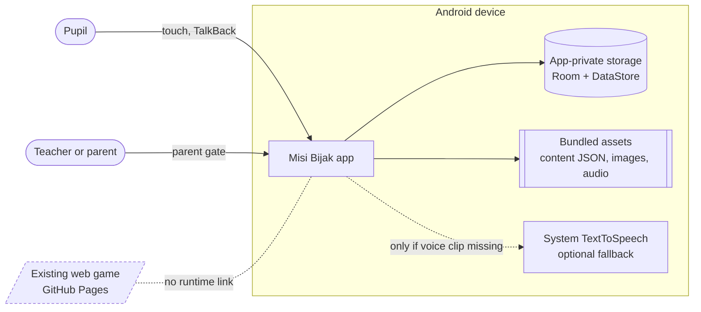
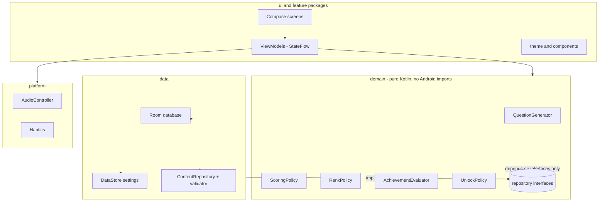
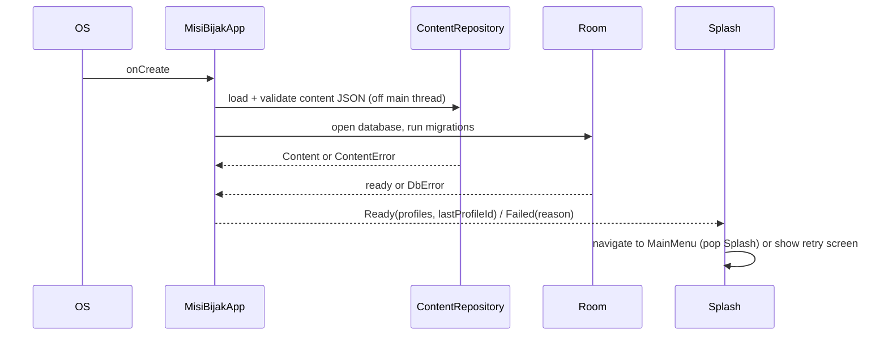
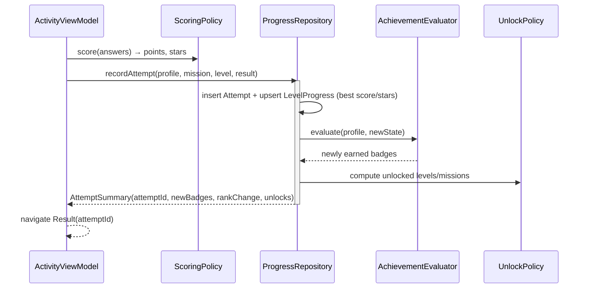
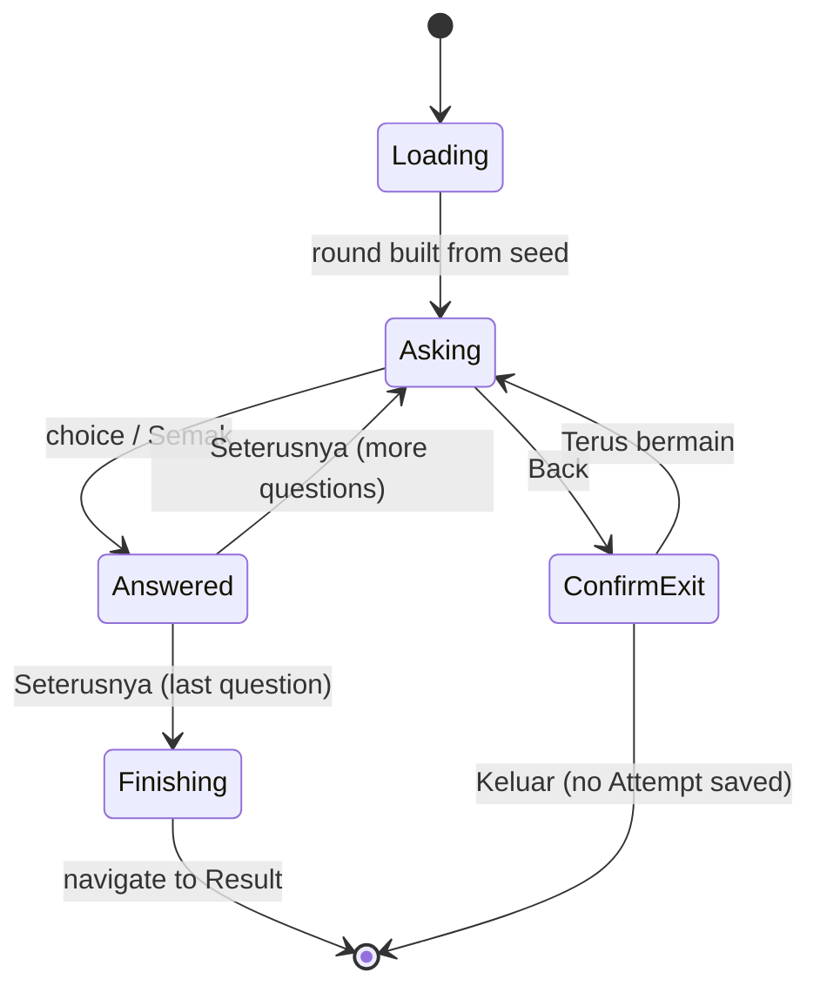

# 02 — Architecture

Scope: structure and rules for the Android V1 app. No application source exists yet. Library versions are deliberately not pinned here (UNKNOWN until M0 checks current stable releases).

Diagrams are Mermaid. Render status is stated in the Phase 2 report.

## 1. System context

The app is a closed box: nothing leaves the device, nothing arrives except the installer.



Rules that follow from the context:

- No `INTERNET` or `ACCESS_NETWORK_STATE` permission, no network library, no analytics/ads SDK (gate G6).
- Content is read from `assets/`; the web game and the app share *content*, never code or runtime.
- `allowBackup=false` (P6) so progress is not copied to a cloud account.

## 2. Layers and dependency rule



Allowed edges: `ui → domain`, `ui → platform`, `data → domain` (implements interfaces). **Forbidden:** `domain → data`, `domain → android.*`, `ui → data` implementations (injected as interfaces), any package → network. Enforced by an architecture test (a simple source-import check is enough at this size) in gate G4.

## 3. Package layout (single Gradle module `app`)

```text
android/app/src/main/java/my/misibijak/
  MisiBijakApp.kt            Application, builds AppContainer
  MainActivity.kt            Single activity, edge-to-edge, NavHost
  navigation/                Route types, NavHost, guards  (see 03)
  ui/theme/  ui/components/  Tokens, BigButton, AnswerTile, StarRow, Mascot, ParentGate, ConfirmDialog
  feature/{splash,menu,profile,map,levels,activity,feedback,achievements,settings}/
  domain/                    model, policy, generator, repository interfaces  (see 04)
  data/{db,settings,content}/
  audio/                     AudioController (SoundPool + MediaPlayer + TTS fallback)
android/app/src/main/assets/content/   words.json sentences.json missions.json characters.json achievements.json
android/app/src/main/assets/audio/     copied from the web assets once cleared (see 08)
android/app/src/main/res/values/       strings.xml (ms default)
tools/export-content.js                M0: reads js/questions.js read-only → content JSON; `--check` for CI
```

`applicationId` and package name are UNKNOWN (owner must choose a domain/namespace). `my.misibijak` above is a placeholder.

## 4. Runtime flows

### 4.1 Cold start



### 4.2 Finishing a round (single transaction)



Atomicity: one Room `@Transaction`. If the process dies mid-way, either all of attempt, progress and achievements are stored or none.

### 4.3 Activity state machine



The round is generated from a stored `roundSeed` and the answers so far are kept in `SavedStateHandle`, so rotation, font-scale changes and process death resume the *same* questions.

## 5. Cross-cutting design

| Concern | Design |
|---|---|
| Randomness | `QuestionGenerator(Random)`; production seeds from `SecureRandom`; tests inject fixed seeds |
| Errors | Content/DB failures surface as a typed `AppError` and a friendly Bahasa Melayu retry screen; never a crash dialog |
| Threading | Disk and JSON work on `Dispatchers.IO`; UI state via `StateFlow`; no `GlobalScope` |
| Audio | One `AudioController`; SFX through `SoundPool`, voice through `MediaPlayer`; stop on screen exit; handles audio focus; TTS fallback only if the system has an `ms-MY` voice, otherwise visible "Audio tidak tersedia" |
| Accessibility | Tokens enforce contrast and 48 dp minimum (64 dp for primary actions); every screen has a heading and logical focus order; `reducedMotion` setting plus system animator scale |
| Localisation | `strings.xml` default is `ms`; no English strings visible to pupils |
| Logging | Debug builds only, no PII (nicknames never logged); release logging off |
| Security | Single exported activity (launcher); no content providers, no deep links, no WebView, no cleartext (irrelevant without network) |
| Build | Gradle wrapper + version catalog; R8 on release; `dependenciesInfo` excluded from APK/AAB (P-proposal, avoids extra metadata blob) |

## 6. Why these choices (short)

- **Single module**: ~25 screens/components do not justify module overhead; the layering rule gives most of the benefit. Revisit if build time > 2 minutes clean (a threshold I made up; adjust).
- **Manual DI**: one `AppContainer` constructed in `Application` is clear and has no annotation processing. Cost: manual wiring in tests.
- **Room over files**: multiple profiles + attempts + transactional unlocks justify a database; DataStore would not give transactions.
- **Content as JSON**: keeps teacher-reviewable content out of Kotlin and enables the export/parity check with the web data.
