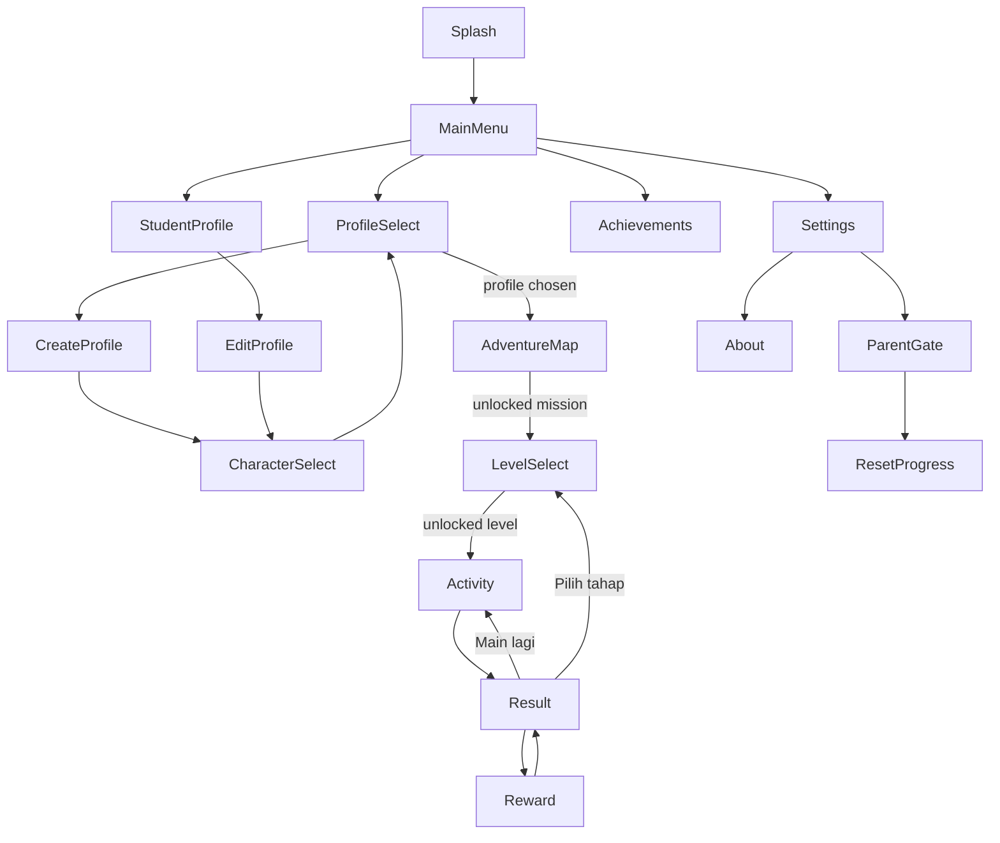

# 03 — Navigation contracts

Specification only. Kotlin shown is the *contract*, not source code in the repo. Types use Navigation Compose with serialisable routes (exact API per the version pinned at M0).

## 1. Graph

(`Reward` is shown once per queued badge or rank-up, then returns to `Result`.)

## 2. Route contract

| Route | Arguments | Guard (checked before showing) | If guard fails | Result back to caller |
|---|---|---|---|---|
| `Splash` | — | — | — | — |
| `MainMenu` | — | — | — | — |
| `ProfileSelect` | `purpose: Play \| Manage` | — | — | `profileId` via `SavedStateHandle` |
| `CreateProfile` | — | profile count < max (P7: 20) | Show "Penuh" message, pop | — |
| `CharacterSelect` | `profileId?` (null = creating), `draftNickname?` | — | — | `characterId` |
| `AdventureMap` | — | active profile exists | Redirect `ProfileSelect(Play)` | — |
| `LevelSelect` | `missionId` | mission unlocked for active profile | Pop with friendly hint (not an error) | — |
| `Activity` | `missionId`, `levelIndex`, `roundId` (UUID created by caller) | level unlocked; `roundId` unseen or resumable | Pop to `LevelSelect` | none — outcome persisted, not returned |
| `Result` | `attemptId` | attempt exists and belongs to active profile | Pop to `AdventureMap` | — |
| `Reward` | `attemptId`, `index` | index < pending rewards for that attempt | Pop to `Result` | — |
| `StudentProfile` | — | active profile | Redirect `ProfileSelect(Play)` | — |
| `Achievements` | — | active profile | Redirect `ProfileSelect(Play)` | — |
| `Settings` | — | — | — | — |
| `ParentGate` | `action: ResetProfile \| ResetAll` | — | — | `passed: Boolean` |
| `About` | — | — | — | — |

Contract rules:

1. **Arguments are identifiers, never data.** `Result` receives `attemptId`, not a score; the screen reads the stored attempt. This prevents tampering via restored state and survives process death.
2. **No deep links.** The manifest declares no intent filters other than `MAIN/LAUNCHER`. All other components are `exported="false"`.
3. **Guards run in the ViewModel from stored state**, not from the route arguments, so a stale back-stack entry cannot open a locked level.
4. **Locked is not an error.** Tapping a locked mission/level shows a short spoken/visible hint ("Dapatkan satu bintang di tahap sebelum ini"), with no dialog.
5. **Rounds are idempotent.** If `Activity` is re-entered with the same `roundId` (rotation, process death) it resumes the stored seed and answers; a completed `roundId` cannot be scored twice (unique `Attempt.roundId`).

## 3. Back-stack behaviour

| From | Back does |
|---|---|
| `Splash` | Removed from stack on advance; Back never returns to it |
| `MainMenu` | Exits the app |
| `ProfileSelect`, `AdventureMap`, `LevelSelect`, `StudentProfile`, `Achievements`, `Settings`, `About` | Pop one level |
| `Activity` | Opens `ConfirmExit` ("Keluar dari misi?"). Confirm → no `Attempt` is stored, pop to `LevelSelect`. Cancel → stay |
| `Result` | Goes to `LevelSelect` (never back into a finished `Activity`) |
| `Reward` | Dismisses to `Result` (does not skip remaining queued rewards; they remain pending) |
| `ParentGate` | Cancels the action |

## 4. State owned per destination

| Destination | State holder | Survives rotation | Survives process death |
|---|---|---|---|
| `Activity` | `ActivityViewModel` + `SavedStateHandle` (`roundSeed`, `answers[]`, `index`) | yes | yes |
| `CreateProfile`/`CharacterSelect` | `ProfileFormViewModel` + `SavedStateHandle` (draft nickname, selected character) | yes | yes |
| Others | read-only flows from Room/DataStore | n/a | n/a |

## 5. Contract tests (to be written in M3/M6)

- Every route in the table has a navigation test for each guard outcome.
- Process-death test: start `Activity`, answer 3 questions, kill/restore, assert same 8 questions and 3 recorded answers.
- Locked level cannot be opened by restoring a stale back stack.
- Manifest test: only launcher is exported; no `<intent-filter>` with `VIEW`.
