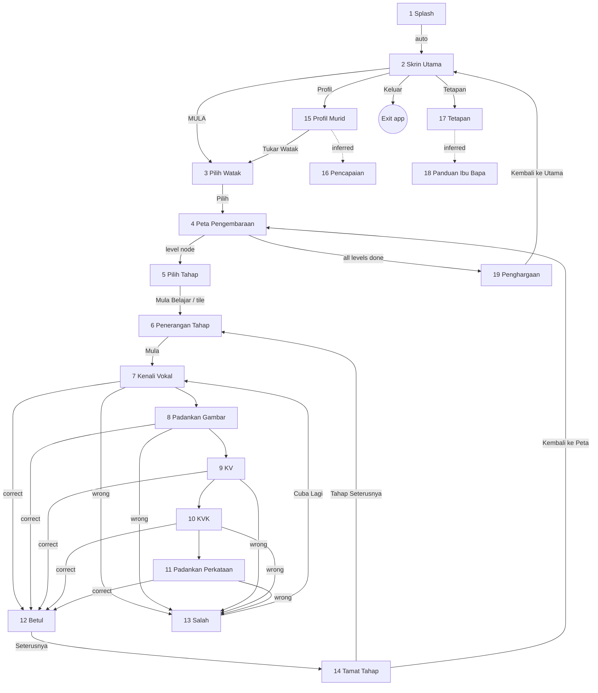

# 05 — Screen specification (from Design Board V1)

**Status:** board received and stored; all 19 numbered screens specified below. Screens **1 (Splash)** and **2 (Skrin Utama)** are implemented in UI-01; the other 17 are specification only.

This document replaces the Phase 2 version, whose `PENDING-BOARD` fields are now filled. Where the board and my earlier assumptions disagree, the board is treated as the visual source of truth (decision from Cowlick UI-01) **except** for accessibility, privacy and offline rules, which stay binding (§2, §7).

## 0. Source and how to read this

| Item | Fact | Status |
|---|---|---|
| File | `design/design-board-v1.png`, 1312 × 1199 px, SHA-256 `b07f8285…711e`; per-screen crops in `design/crops/` | VERIFIED |
| Content | Header with app info panel, 19 numbered phone frames in three rows, a "Warna & Gaya Visual" panel | VERIFIED (viewed) |
| Frames | Portrait phones only; each frame is ~175 × 285 px, so fine detail and small text are low resolution | VERIFIED |
| Tablet / landscape frames | None | VERIFIED |
| Legibility | Some micro-text on the board is garbled or cut off (e.g. the blue button on screen 14 reads "Kembeli ke Peta"; badge captions on screen 16 are unreadable; caption of 14 is truncated). Copy below uses the legible text and flags my corrections | VERIFIED |
| Provenance and licence of the artwork | Not stated. The picture has characteristics typical of generated imagery (garbled micro-text) | UNKNOWN / ASSUMED |
| Separate artwork files | **Not supplied.** Only this flattened picture exists, so characters, scenery and pictures cannot be extracted at shipping quality or licence | VERIFIED |

Colours were **sampled from the board's pixels** (`Palette.kt` records each source). Layout fractions for screens 1–2 were measured on 3× crops and are accurate to about ±3% of screen height. All other layout notes are descriptive, not measured.

Board header facts (project info panel): app name *Misi Bijak Bahasa Melayu*; target *Murid Tahap 1 (Pemulihan)*; platform *Android (Telefon & Tablet)*; mode *Offline (tanpa internet)*; ads *Tiada*; login *Tidak diperlukan*; key features *interaktif, berperingkat, ganjaran, bunyi*; language *Bahasa Melayu*. These agree with decisions A2 and A6.

## 1. Board-to-requirement coverage and discrepancies

The board is rich but does not cover everything already approved. These are findings for Cowlick, not silent changes.

| # | Finding | Evidence | Impact |
|---|---|---|---|
| B1 | **Susun Huruf (letter arrangement) and Ayat Mudah (simple sentences) have no frames.** The board has five activities: Kenali Vokal, Padankan Gambar (picture → vowel), KV, KVK, Padankan Perkataan (picture → word). The brief requires vowels, KV, KVK, image matching, **letter arrangement** and **simple sentences** | Screens 7–11 | Two of six game types have no approved visual. New question Q11 |
| B2 | The board's hierarchy is *Pulau Kata map → Tahap (theme, e.g. "Kenali Vokal") → grid of 9 tiles → level description → activities*. The approved decision says "three levels per mission". The 3×3 grid on screen 5 shows 3 unlocked tiles with stars and 6 locked, which can be read as 9 stages per Tahap. How "mission", "Tahap" and "three levels" relate is unresolved | Screens 4–6 | Data model and unlock rule (Q1, Q12) |
| B3 | Map node labels read **1, 3, 3** (the second node is probably meant to be "2") | Screen 4 | Copy typo; treated as 1, 2, 3 |
| B4 | Results screen shows **Skor : 100**, **Jawapan Betul : 10/10** and **Masa : 2 minit** → 10 questions per round, 10 points each. The web game uses 8 questions and a maximum of 80 points | Screen 14 | Breaks the "parity with web scoring" assumption in `04-domain-and-content.md` (Q13) |
| B5 | Wrong-answer screen says "Itu bukan jawapan yang betul. Jangan putus asa!" with a **Cuba Lagi** button, i.e. a retry. My earlier spec (and the web game) reveal the answer and lock | Screen 13 | Behaviour change: retry the same question (Q14) |
| B6 | Main menu has **Tetapan, Profil, Keluar** but no Pencapaian entry; achievements (16) must be reached from elsewhere (profile is the likely parent) | Screens 2, 15, 16 | Navigation assumption (ASSUMED) |
| B7 | **No screen for entering a nickname / choosing a profile.** Screen 3 picks a character; screen 15 shows "Nama : Adik Bijak" and "Watak : Amir". Decision A6 (nickname-only local profiles) therefore has no designed entry point; the multi-profile selector I proposed is also not on the board | Screens 3, 15 | Needs a frame (Q15) |
| B8 | Screen 3 shows **5 characters**: two large (boy on yellow, hijab girl on pink) and three small, of which the first looks unlocked and two show padlocks. That reads as "3 available at start, 2 to unlock", consistent with decision A3 | Screen 3 | ASSUMED reading |
| B9 | Settings has **Muzik** toggle, **Bahasa** dropdown ("Bahasa Melayu") and **Saiz Teks** dropdown ("Biasa"), and **Padam Semua Data**. There is no parent gate, About/licences, reduced-motion, or per-profile delete | Screen 17 | No music track exists (licence); one language only; destructive action needs a guard (spec wins) |
| B10 | Screen 18 *Panduan Ibu Bapa* and screen 19 *Penghargaan* were not in my earlier list; there is no entry point shown for 18 | Screens 18, 19 | Entry point UNKNOWN |
| B11 | Content questions inside the pictures: screen 10 shows a cat picture with the pattern "k _ t" (not an obvious Malay word for a cat); screen 11 shows a **sun** with options *mata / batu / satu* (the Malay word is *matahari*, which is not offered) | Screens 10, 11 | Pedagogy review needed (Q9) |
| B12 | The main menu frame has a back arrow in the top-left although it is the root screen | Screen 2 | Not implemented (root screen has no back) |
| B13 | Several board button colours fail AA contrast for their label (§3.3) | Palette | Spec wins: dark labels or darker faces |

Earlier-spec screens that the board does not show and that remain required: profile selection/creation (B7), parent gate for destructive actions, About/licences, error/retry, and the two missing activities (B1).

## 2. Global rules (unchanged, still binding)

1. Touch targets ≥ 48 × 48 dp; primary actions and answer tiles ≥ 64 dp tall; ≥ 8 dp between targets. The board's back arrow is drawn ≈ 24 px on a ≈ 285 px-tall frame (≈ 8% of height ≈ 70 dp on a 891 dp-tall phone) — fine, but must be ≥ 48 dp on short screens.
2. Text contrast ≥ 4.5:1 (≥ 3:1 for ≥ 24 dp or bold ≥ 18.66 dp text and for graphics).
3. Must hold at 200% font scale on 360 dp width: content scrolls rather than clips.
4. Compact (< 600 dp) single column; wider/landscape arrangements are designed from the portrait board (no tablet frames exist).
5. Every non-decorative element has a Bahasa Melayu `contentDescription`; scenery and mascots are decorative.
6. Meaning is never colour-only.
7. Respect system animation scale; no network, ads, analytics or permission prompts.
8. Names shown are nicknames only (A6).

## 3. Design system extracted from the board

### 3.1 Colours

Swatches from the "Warna & Gaya Visual" panel were sampled from their centre pixels. Values for gradients/scenery are sampled or derived and marked.

| Token | Hex | Source | Used for |
|---|---|---|---|
| `BLUE` | `#0179DC` | swatch 1 (VERIFIED sample) | Primary action (board: *Pilih*, *Kembali ke Peta*), links, icons |
| `PINK` | `#FB688E` | swatch 2 | Secondary action (*Mula*, *Cuba Lagi*, *Padam Semua Data*), highlights |
| `YELLOW` | `#FCC328` | swatch 3 | Stars, call-to-action base (MULA), tiles |
| `GREEN` | `#86D842` | swatch 4 | Success, progress, *Mula Belajar* |
| `PURPLE` | `#AD7FF1` | swatch 5 | Section labels (screen titles on board header), tiles, locked tiles |
| `PEACH` | `#FBDCC2` | swatch 6 | Soft backgrounds, tiles |
| `CREAM` | `#FEFCF6` | sampled card background (screen 3) | Card surfaces |
| `INK` | `#10213D` | derived (board text is near-black navy) | Text, outlines |
| `MULA_TOP/BOTTOM` | `#FDDA21` / `#FDC121` | sampled from MULA button | Button gradient |
| `TITLE_YELLOW` | `#FCF002` | sampled splash title line 1 | Splash logo |
| `TITLE_ORANGE` | `#FF9303` | sampled menu title line 1 | Menu logo |
| `SKY_TOP/HORIZON` | `#59CBF3` / `#C9F0FB` | derived from sampled sky | Backgrounds |
| `HILL…`, `TREE…`, `MOUNTAIN…`, `SAND…` | see `Palette.kt` | derived | Code-drawn scenery |
| `BLUE_ACCESSIBLE` (proposed) | `#0069C7` | derived, 5.46:1 with white | White-label buttons |

Other board colours seen but not yet tokenised (screens 3–19): pastel tile colours (peach, light green, sky blue, pink, yellow, lilac), gold/grey badge metals, success-green and failure-pink full-screen gradients, red destructive button.

### 3.2 Typography

| Role | Board | Implementation |
|---|---|---|
| Face | "Poppins / Nunito (mesra kanak-kanak)" | **Nunito** bundled (Bold 700, ExtraBold 800, Black 900; SIL OFL 1.1). Poppins not bundled (not needed for UI-01; adds an asset to license-review) |
| Logo/title | Heavy rounded face, white/yellow/orange fill with thick dark outline | Nunito Black with stroke outline; size follows container width: `width / 8.4`, clamped 24–60 sp |
| Screen title | Bold, dark navy, centred, ≈ 20–26 sp equivalent | `titleLarge` 22 sp ExtraBold |
| Instruction/sub-title | Regular-weight small text under the title | `bodyMedium` 16 sp Bold |
| Letter/tile glyphs (7–11) | Very large (≈ 40–48 sp), bold, dark | 48 sp Black (to be built) |
| Button label | Bold; MULA is extra large | 32 sp Black (primary), 18–20 sp ExtraBold (standard) |
| Caption | Small bold under icons | 16 sp ExtraBold |

Differences: the board's logo face is a display font not named on the board; Nunito Black is the nearest permitted face. All sizes are `sp` and scale with the user's font size, except the logo.

### 3.3 Contrast review of board colour pairs

Ratios computed from the sampled swatches (flat colours; the board's buttons use gradients and are slightly darker than the swatch, exact values UNKNOWN).

| Pair | Ratio | Result | Decision |
|---|---|---|---|
| White on `BLUE` | 4.40 | Fails AA (just) | Use `BLUE_ACCESSIBLE` `#0069C7` (5.46) for white-label buttons |
| White on `PINK` | 2.81 | **Fails** | Dark `INK` label on pink (5.72) |
| White on `GREEN` | 1.76 | **Fails** | `INK` label on green (9.12) |
| White on `YELLOW` | 1.62 | **Fails** | `INK` label (9.93) — matches the board's MULA, which already uses dark text |
| White on `PURPLE` | 2.96 | **Fails** | `INK` label (5.42) |
| `INK` on `BLUE` | 3.65 | Fails for small text | Do not use dark text on `BLUE` |
| `INK` on pastel tiles (peach, mint, sky…) | ≥ 9 | Passes | As on the board |

`ContrastTest.kt` enforces the pairs actually used and documents that white-on-pink fails.

### 3.4 Shape, spacing, elevation

Observed: cards with large rounded corners (≈ 24–28 dp), pill buttons (full radius) with a darker lower edge to suggest 3D depth, square-ish pastel tiles with ≈ 16–20 dp radius, white 3 px outlines on round buttons and progress bar. Spacing follows a 4 dp base grid (4/8/12/16/24/32). Implemented in `Dimens.kt`; primary button depth 6 dp.

### 3.5 Iconography (board panel "Ikon")

Back arrow (circular, teal/blue; red and orange variants on the map), home, settings gear, star (gold), speaker, padlock. Also seen: person/profile, exit, checkmarks, dropdown chevrons, toggles. UI-01 uses Material icon *glyphs* (`Settings`, `Person`, `ExitToApp`) inside gradient circles; the board's glossy 3D icons are not available as assets.

### 3.6 Component inventory

| ID | Component | Screens | UI-01 |
|---|---|---|---|
| C01 | Scene background (sky, mountains, meadow, path) | 1, 2 (+ similar on 3–19 headers) | **Placeholder, code-drawn** |
| C02 | Logo wordmark (two-line outlined title) | 1, 2 | **Implemented** (`GameTitle`, `OutlinedText`) |
| C03 | 3D pill button (MULA; also green/pink/blue variants) | 2, 3, 5, 6, 12–14, 15, 17, 19 | **Implemented** (`PillButton`, yellow variant used) |
| C04 | Round icon button with caption | 2 | **Implemented** (`RoundIconButton`) |
| C05 | Determinate loading bar | 1 | **Implemented** (`LoadingBar`) |
| C06 | Mascot illustrations (boy, cat, hijab girl, small boy, family) | 1–3, 6, 9–15, 18, 19 | **Boy and cat placeholders only** |
| C07 | Back button (circle) | 3–19 (also 2 on the board) | Not started |
| C08 | Sky-header + cream card screen frame | 3, 5–11, 15–18 | Not started |
| C09 | Letter / syllable tile (pastel colour set) | 7–10 | Not started |
| C10 | Speaker (play sound) button | 7, 8, 9 | Not started |
| C11 | Picture card | 8–11 | Not started |
| C12 | Word option pill | 11 | Not started |
| C13 | Formula pill ("b + a = ba") and blank pattern ("k _ t") | 9, 10 | Not started |
| C14 | Star row (earned / empty) | 4, 5, 12, 14, 16 | Not started |
| C15 | Level node bubble on map | 4 | Not started |
| C16 | Level tile (unlocked with stars / locked padlock) | 5 | Not started |
| C17 | Checklist item | 6 | Not started |
| C18 | Result/stat row ("Skor : 100") | 14, 15 | Not started |
| C19 | Badge tile (earned gold, grey, locked) | 16 | Not started |
| C20 | Toggle row, dropdown row | 17 | Not started |
| C21 | Character card (selected / locked) | 3 | Not started |
| C22 | Feedback full-screen (success / failure) | 12, 13 | Not started |
| — | Coming-soon dialog | UI-01 only | Implemented; **not on the board** — temporary placeholder |

## 4. Navigation (as drawn on the board and as inferred)

Arrows marked *(inferred)* are my reading; the board shows no arrows.

Notes: the order of activities 7 → 11 inside one Tahap is not shown (they may be different Tahap themes rather than a sequence — Q12). Back arrows (top-left) return to the previous screen; the map additionally shows a second orange arrow at the bottom-left (purpose unknown). Entry points for 16 and 18 are not shown.

## 5. Screen-by-screen specification

Each entry lists what the board shows (VERIFIED by viewing the crop), the implementation notes, and status. Crops: `design/crops/NN-*.png`.

### 1 · Splash Screen — IMPLEMENTED (UI-01)
- **Board:** daytime scene (sky, clouds, purple mountains, green hills, winding sand path, trees). Logo near the top: line 1 "Misi Bijak" yellow, line 2 "Bahasa Melayu" white, both with a thick dark outline. The boy (cap, backpack) waves in the lower middle. Blue progress bar with white rim (≈ 40% filled) above the caption "Memuatkan pengembaraan…" (dark text). System status icons at the top.
- **Measured layout (fractions of screen height/width):** logo block centre ≈ 28% from the top, ≈ 17% tall, ≈ 83% wide; boy ≈ 47–83% from the top, centred slightly left; bar ≈ 87% from the top, ≈ 62% wide; caption ≈ 93%.
- **Behaviour:** shown ≥ 1.8 s and until initialisation is ready; then goes to Skrin Utama and is removed from the back stack. Bar is a timed animation (no real loading work exists yet).
- **A11y:** logo is one heading "Misi Bijak Bahasa Melayu"; bar exposes `ProgressBarRangeInfo` and the description "Memuatkan pengembaraan"; scenery and mascot hidden.
- **States:** progress 0–100%; (error state S23 from the earlier spec is not built yet).

### 2 · Skrin Utama — IMPLEMENTED (UI-01)
- **Board:** same scene. Logo with line 1 orange, line 2 white. Ginger cat sitting behind the top edge of a large yellow pill button "MULA" (dark text). Beneath, three round icon buttons with captions **Tetapan** (blue gear), **Profil** (green person), **Keluar** (blue-grey person/door). A small back-arrow circle appears at the top-left (B12, not implemented).
- **Measured layout:** logo centre ≈ 22%; cat ≈ 39–59%; MULA ≈ 61–74% tall button ≈ 77% wide; icon row ≈ 80–92%.
- **Behaviour:** MULA → character selection (3), Tetapan → 17, Profil → 15, Keluar → closes the app. Until those screens exist (UI-02+), MULA/Tetapan/Profil show a temporary "Akan datang" dialog; **Keluar works**.
- **A11y:** MULA announces "Mula bermain" (avoids spelling out capitals), three captioned buttons ≥ 48 dp, title heading.
- **Responsive:** portrait column ≤ 520 dp wide, centred; landscape (> 1.15 aspect) uses two columns; scrolls at large font sizes.

### 3 · Pilih Watak — NOT STARTED
- **Board:** sky header; cream card titled "Pilih Watak Anda"; two large portraits (boy on yellow, hijab girl on pink); below, three small portraits (boy on light blue; two locked: one grey with a padlock, one dark with a padlock); blue button "Pilih". Back arrow top-left. Caption: pick a favourite character; others unlock at certain levels.
- **Spec:** single-select cards (radio semantics); locked cards non-selectable with a spoken reason; 3 available initially (B8); *Pilih* enabled once a character is chosen. Character names UNKNOWN (Q3). Button colour per §3.3.

### 4 · Peta Pengembaraan — NOT STARTED
- **Board:** island map "Pulau Kata" banner (dark-blue ribbon), winding path with numbered bubbles carrying 3 stars each (1, 3, 3 — B3), treasure chest bottom-right, tree and hut details, red back arrow top-left, orange arrow bottom-left.
- **Spec:** nodes in order; locked/unlocked/complete states; operable without gestures (list-style TalkBack traversal); stars out of 3 per node.

### 5 · Pilih Tahap — NOT STARTED
- **Board:** card "Tahap 1 / Kenali Vokal"; 3×3 grid: row 1 three coloured tiles with small icons and three stars each; rows 2–3 locked (lilac, padlock); green button "Mula Belajar".
- **Spec:** see B2 (nine stages). Locked tiles announce "terkunci". Button: dark label on green (§3.3).

### 6 · Penerangan Tahap — NOT STARTED
- **Board:** title "Tahap 1 / Kenali Vokal"; panel "Apa yang akan anda pelajari?" with a checklist ("Mengenal huruf vokal", "Menyebut bunyi dengan betul", "Latihan interaktif yang menyeronokkan"); cat illustration; pink button "Mula".
- **Spec:** objectives come from content; button label dark on pink.

### 7 · Aktiviti 1 – Kenali Vokal — NOT STARTED
- **Board:** title "Kenali Huruf Vokal", hint "Tekan huruf untuk dengar bunyi."; five big letter tiles a (peach), e (green), i (light blue), o (lilac), u (yellow); round blue speaker button bottom-right.
- **Spec:** a *learning* screen (no scoring on the board): tapping a tile plays the letter sound. **Vowel letter-sound audio does not exist** (only 48 word clips and 24 sentences exist — VERIFIED) → asset needed.

### 8 · Aktiviti 2 – Padankan Gambar — NOT STARTED
- **Board:** "Padankan Huruf Vokal", hint "Pilih huruf yang sesuai dengan gambar."; picture card with a red apple, lilac speaker button; five pastel tiles a e i o u.
- **Spec:** answer = first vowel of the pictured word (apple = *epal* → e). Picture must be bundled, accurate art.

### 9 · Aktiviti 3 – KV — NOT STARTED
- **Board:** "Baca Suku Kata"; formula pill "b + a = ba" with a blue speaker button; a picture card (boy); options ba (peach), be (green), bi (green), bo (blue).
- **Spec:** formula shows the target syllable; option colours should not be the only distinction.

### 10 · Aktiviti 4 – KVK — NOT STARTED
- **Board:** "Bina Suku Kata", hint "Pilih huruf yang betul."; cat picture; pattern "k ___ t"; options a e i o.
- **Spec:** content review needed (B11).

### 11 · Aktiviti 5 – Padankan Perkataan — NOT STARTED
- **Board:** "Padankan Perkataan", hint "Pilih perkataan yang sesuai."; sun picture; three white pill options *mata*, *batu*, *satu*.
- **Spec:** content review (B11). This is the board's counterpart to the web "Padan Gambar".

### 12 · Maklum Balas Betul — NOT STARTED
- **Board:** light-green gradient; outlined "Bagus!"; three gold stars; celebrating boy; text "Jawapan kamu betul!"; green button "Seterusnya". Caption: animation and sound.
- **Spec:** respects reduced motion; text and icon, not colour alone; live-region announcement.

### 13 · Maklum Balas Salah — NOT STARTED
- **Board:** light-pink gradient; outlined "Cuba Lagi!"; sad boy with hearts; text "Itu bukan jawapan yang betul. Jangan putus asa!"; pink button "Cuba Lagi".
- **Spec:** retry flow (B5); encouraging tone.

### 14 · Tamat Tahap — NOT STARTED
- **Board:** "Tahniah!", three gold stars, panel "Skor : 100 / Masa : 2 minit / Jawapan Betul : 10/10", green "Tahap Seterusnya", blue "Kembali ke Peta" (printed "Kembeli ke Peta"; corrected).
- **Spec:** needs duration capture (`Attempt.durationMs` already planned) and a 10-question round (B4).

### 15 · Profil Murid — NOT STARTED
- **Board:** "Profil Saya"; portrait; "Nama : Adik Bijak", "Tahap Semasa : 3", "Jumlah Bintang : 24", "Watak : Amir"; light-blue button "Tukar Watak".
- **Spec:** shows a nickname only. "Tahap Semasa" is a level number; "Jumlah Bintang" counts stars, not points (B4/terminology).

### 16 · Pencapaian — NOT STARTED
- **Board:** "Pencapaian Saya"; three star badges (two gold, one grey) and three locked grey badges; pill "Bintang Terkumpul : 24".
- **Spec:** badge names unreadable on the board; achievement list still to be approved (P13).

### 17 · Tetapan — NOT STARTED
- **Board:** "Tetapan"; rows Bunyi (toggle on), Muzik (toggle on), Bahasa (dropdown "Bahasa Melayu"), Saiz Teks (dropdown "Biasa"); red/pink button "Padam Semua Data".
- **Spec:** Muzik toggle has no music asset (B9); Bahasa dropdown has a single option; Padam Semua Data must be behind a parent gate (not on the board — spec wins).

### 18 · Bantuan / Panduan — NOT STARTED
- **Board:** "Panduan Ibu Bapa"; numbered list: 1 Cara menggunakan aplikasi, 2 Penerangan tahap pembelajaran, 3 Tips membantu anak, 4 Soalan Lazim (FAQ); illustration of a mother and child reading with the cat.
- **Spec:** static text; copy to be written and teacher-reviewed. Entry point UNKNOWN.

### 19 · Penghargaan — NOT STARTED
- **Board:** "Terima Kasih!" / "Teruskan Pengembaraan Bahasa Melayu!"; three children illustrated; blue button "Kembali ke Utama".
- **Spec:** shown after completing all levels.

## 6. Reconciliation with the Phase 2 inventory (S01–S23)

| Phase 2 | Board | Note |
|---|---|---|
| S01 Splash | 1 | Implemented |
| S02 MainMenu | 2 | Implemented; "Pencapaian" button dropped (board has none) |
| S03 ProfileSelect, S04 CreateProfile | — | Not on board (B7) |
| S05 CharacterSelect | 3 | |
| S06 AdventureMap | 4 | |
| S07 LevelSelect | 5, 6 | Board splits selection (5) and description (6) |
| S08 ActivityScaffold, S09–S14 | 7–11 | Susun Huruf and Ayat Mudah missing (B1); Vokal is a learning screen |
| S15 Feedback | 12, 13 | Retry (B5) |
| S16 Result | 14 | |
| S17 Reward | 19 (end of game) / 16 | Rewards between rounds not drawn |
| S18 Profile | 15 | |
| S19 Achievements | 16 | |
| S20 Settings | 17 | |
| S21 ParentGate, S22 About/Licences, S23 Error | — | Not on board; still required |
| — | 18 Panduan | New |

## 7. Open questions raised by the board

| ID | Question |
|---|---|
| Q11 | Provide frames (or approve my derived designs) for **Susun Huruf** and **Ayat Mudah** |
| Q12 | Define the hierarchy: map node vs Tahap vs "9 tiles" vs "three levels per mission"; and whether activities 7–11 are sequential inside one Tahap |
| Q13 | 10 questions and 100 points per round (board) vs 8 and 80 (web)? Which wins for Android? |
| Q14 | Confirm retry-on-wrong behaviour (board) over reveal-and-lock (web) |
| Q15 | Where does a pupil enter a nickname, and is there a profile selector? |
| Q16 | Provide artwork as files (SVG/PNG, transparent background) with licence, or authorise commissioning/creation of original replacements |
| Q17 | Confirm "Muzik": supply a licensed track or remove the toggle |
| Q18 | Entry points for screens 16 (Pencapaian) and 18 (Panduan) |
